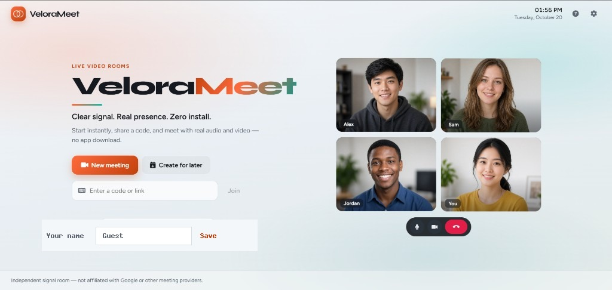

# VeloraMeet — Web Video Meetings

Independent browser video conferencing for small rooms (WebRTC mesh + PHP/MySQL signaling).  
**Not affiliated with Google Meet** or any commercial conferencing brand.



## Quick start (XAMPP)

1. Place the project at `C:\xampp\htdocs\project\Google_Meet`
2. Copy `config/config.example.php` → `config/config.php` and fill in **your own** DB settings + `base_url`
3. Start Apache + MySQL in XAMPP
4. Import `database/install.sql` in phpMyAdmin (or run `php tests/setup_db.php`)
5. Open http://localhost/project/Google_Meet/
6. Set a display name → **New meeting** → preview in the lobby → **Join now**
7. Open the same link in a second browser tab/profile with a different name to test A/V
8. Health check: http://localhost/project/Google_Meet/api/health.php → expect `"database":"ok"`

Typical local values:

| Setting | Example (do not copy production secrets here) |
|--------|-----------------------------------------------|
| `base_url` | `http://localhost/project/Google_Meet` |
| `db.host` | `127.0.0.1` |
| `db.name` | `connectmeet` |
| `db.user` | `root` |
| `db.pass` | *your local MySQL password* |
| `session.secure` | `false` on local HTTP |

> **Security:** Never put real cPanel / hosting passwords in README, screenshots, or git.  
> `config/config.php` is gitignored. Commit only `config.example.php`.

## Screenshots

| Home |
|:---:|
|  |

## Features

- Instant meetings and “create for later” shareable links
- Unique meeting codes (`xxx-xxxx-xxx`) and room URLs
- Pre-join lobby with live camera / microphone preview
- Real WebRTC mesh audio & video (peer-to-peer)
- Per-tab display names (separate identities while testing)
- Screen sharing, chat, emoji reactions, raise hand
- Optional browser captions (Web Speech API) and local recording
- Device settings (camera / mic / speaker when supported)
- Host controls: lock meeting, remove participant, end for all
- CSRF protection, membership checks, rate limits, PDO prepared statements
- Cleanup script for expired meetings / stale signaling rows

## Folder structure

```
Google_Meet/
├── api/                   REST JSON APIs (meetings, participants, signaling, chat, events, health)
├── assets/css & js        UI + WebRTC / signaling clients
├── assets/images          Brand + home preview photos
├── config/
│   ├── config.example.php Safe template (commit this)
│   └── config.php         Local secrets (gitignored — create from example)
├── database/
│   ├── install.sql        Local XAMPP (creates DB + tables)
│   └── install_cpanel.sql Tables only (shared hosting)
├── docs/                  Architecture, WebRTC, security, cPanel checklist
├── docs/screenshots/      README images
├── includes/              Bootstrap, auth, CSRF, helpers
├── scripts/cleanup.php    Expire / prune old data
├── storage/logs/          App logs (writable; logs gitignored)
├── tests/                 Smoke test + DB helpers
├── index.php              Landing page
├── room.php               Lobby + in-call UI
└── LICENSE                MIT
```

## 1. XAMPP setup

1. Copy this folder to `C:\xampp\htdocs\project\Google_Meet`
2. Start **Apache** and **MySQL**
3. Import the schema:
   - phpMyAdmin → Import `database/install.sql`
   - Or: `C:\xampp\mysql\bin\mysql.exe -u root -p < database\install.sql`
4. Create config from the template:

```bat
copy config\config.example.php config\config.php
```

5. Edit **only** `config/config.php` on your machine (never commit it):
   - `base_url`, `db.*`, `session.secure`
6. Open http://localhost/project/Google_Meet/
7. Optional: `C:\xampp\php\php.exe tests\smoke_test.php`

### Camera / microphone

- **localhost** is a secure context — media usually works
- Plain `http://LAN-IP/...` often blocks camera/mic
- Public hosting requires **HTTPS**

## 2. Using a meeting

1. Enter **Your name** and Save (stored per browser tab)
2. Click **New meeting** (or join with a code / link)
3. In the lobby, toggle mic/camera, then **Join now**
4. Share the meeting code or room URL

| Control | Action |
|--------|--------|
| Mic / Camera | Mute or stop video |
| Captions | Local speech captions (Chrome/Edge) |
| Hand | Raise / lower hand |
| Present | Screen share |
| Record | Local browser recording |
| Chat / People / Info | Side panels |
| Leave | Exit the call |

Shortcuts: `M` mic · `V` camera · `C` chat · `H` hand · `Esc` close panels.

## 3. cPanel / production

See [`docs/CPANEL.md`](docs/CPANEL.md) for the full checklist.

Short version:

1. Enable **HTTPS**
2. PHP **8.2+**
3. Create MySQL database + user in cPanel
4. Import **`database/install_cpanel.sql`**
5. Upload the project; create `config/config.php` **on the server** from `config.example.php`
6. Set production `db.*`, `session.secure => true`, and `base_url` (or `'auto'`)
7. Ensure `storage/logs` is writable
8. Open `/api/health.php` → `"database":"ok"`

Optional cleanup cron (every 10 minutes):

```
php /home/USER/path/to/Google_Meet/scripts/cleanup.php
```

For restrictive NATs, add a managed TURN server in `webrtc.ice_servers` (see comments in `config.example.php`).

## 4. System flow

```
Browser A  ←── WebRTC P2P media ──→  Browser B
    │                                    │
    └──── HTTP JSON short-polling ───────┘
                     │
                PHP + MySQL
         (meetings, participants,
          offers / answers / ICE,
          chat, events)
```

1. Host creates a meeting → code + join URL  
2. Guests join with a display name → participant tokens  
3. Browsers exchange SDP/ICE via PHP APIs  
4. Media flows peer-to-peer (mesh) — keep rooms small (default limit 8)

## 5. Protecting secrets (important)

| Do | Don't |
|----|--------|
| Keep real passwords only in `config/config.php` on the server | Commit `config/config.php` to GitHub |
| Use `config.example.php` with empty / fake placeholders | Paste hosting DB passwords into README or issues |
| Confirm `.gitignore` includes `/config/config.php` | Screenshot phpMyAdmin credentials |
| Rotate DB password if it was ever shared in chat | Re-upload an old zip that embeds production secrets into a public repo |

`.htaccess` also blocks direct HTTP access to `config/`, `includes/`, and `storage/`.

If a production password was exposed, **change it in cPanel immediately**.

## 6. Documentation

| Doc | Topic |
|-----|--------|
| [INSTALLATION.md](INSTALLATION.md) | XAMPP + cPanel install |
| [docs/CPANEL.md](docs/CPANEL.md) | Production checklist |
| [docs/ARCHITECTURE.md](docs/ARCHITECTURE.md) | Design overview |
| [docs/WEBRTC.md](docs/WEBRTC.md) | STUN / TURN / SFU |
| [docs/SECURITY.md](docs/SECURITY.md) | Security details |
| [docs/TROUBLESHOOTING.md](docs/TROUBLESHOOTING.md) | Common fixes |
| [docs/TESTING.md](docs/TESTING.md) | Test notes |
| [docs/LIMITATIONS.md](docs/LIMITATIONS.md) | Known limits |

## Requirements

- PHP 8.2+ (`pdo_mysql`, `json`, `mbstring`, `openssl`)
- MySQL 5.7+ / MariaDB 10.3+
- Modern Chrome, Edge, or Firefox
- Production: HTTPS; TURN recommended for hard networks

## License

This project is licensed under the [MIT License](LICENSE).
